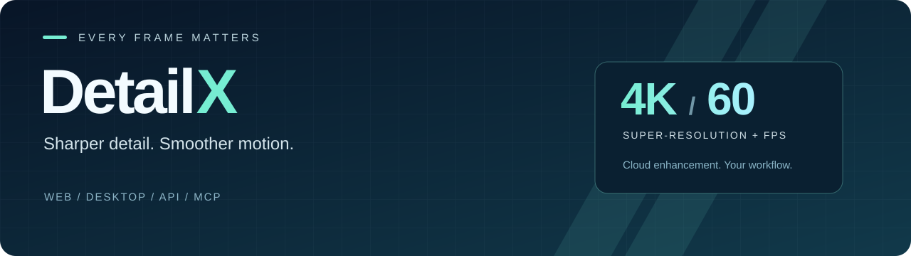

<p align="center">
  
</p>

<p align="center">
  <strong>Sharper detail. Smoother motion. Inside your workflow.</strong><br>
  AI video super-resolution and frame interpolation for creators, developers, and AI assistants.
</p>

<p align="center">
  <a href="https://www.detail-x.ai/">Website</a> ·
  <a href="https://www.detail-x.ai/video-upscaler/">Live comparisons</a> ·
  <a href="https://www.detail-x.ai/download">Desktop app</a> ·
  <a href="MCP.md">MCP guide</a> ·
  <a href="README.zh-CN.md">简体中文</a>
</p>

# DetailX Video Upscaler

DetailX enhances existing video with **up to 4K super-resolution and 60 FPS frame interpolation**. Bring camera footage, older clips, or AI-generated video, choose the look you want, and compare the enhanced result against the original.

Use the Web Studio, Windows/macOS desktop app, REST API, or a remote **OAuth MCP server** connected to your AI assistant. Cloud processing handles the enhancement, so a local inference GPU is not required.

## What DetailX can do

| Capability | What you get |
| --- | --- |
| **Video super-resolution** | Output at 720p, 1080p, 2K, or 4K, with three detail levels to suit the source. |
| **Frame interpolation** | Keep the source frame rate or choose 24, 30, or 60 FPS. |
| **Natural detail enhancement** | Refine hair, skin, fabric, foliage, and material textures; inspect the result on real examples below. |
| **Control over the look** | Color preservation, lighting correction, and optical-flow smoothing controls. |
| **Preview and compare** | Single-frame previews and synchronized original/enhanced comparison in the visual workspace. |
| **Slow motion** | 0.5× and 0.25× workflows in the Web/Desktop experience. |
| **Batch workflows** | Submit multiple clips from the workspace and track accepted jobs in the background. |
| **Assistant integration** | Find media, request quotes, submit authorized enhancements, and retrieve results through MCP. |

## See the difference

These are original and enhanced frames from DetailX's public video examples. Open the [live comparisons](https://www.detail-x.ai/video-upscaler/) to judge motion, temporal consistency, and full-resolution detail; still images cannot demonstrate frame interpolation.

| Original · 480p | DetailX · 4K / 60 FPS output |
| :---: | :---: |
|  |  |

| Original · 720p | DetailX · 4K / 60 FPS output |
| :---: | :---: |
|  |  |

## Why it fits your workflow

- **Resolution and motion in one workflow.** Combine super-resolution and frame interpolation rather than passing clips through separate tools.
- **Preview before a full render.** Inspect a representative frame and adjust enhancement settings in the visual workspace.
- **Cloud compute, familiar tools.** Work from a browser, desktop, code, or an AI assistant; enhancement inference runs in the cloud.
- **One DetailX account.** Web, direct API, and MCP use the same account, credit balance, and task history.
- **Quotes before MCP generation.** Review the estimated credits before authorizing a render. Failed or timed-out enhancement jobs refund their precharge under the service's billing rules.
- **Browser-based MCP authorization.** Connect without manually copying an API key. Manage or revoke connected clients from your DetailX account.

## Get started

| Your workflow | Start here |
| --- | --- |
| Upload and enhance in a browser | [Open DetailX](https://www.detail-x.ai/) |
| Work with local clips on Windows or macOS | [Download the desktop app](https://www.detail-x.ai/download) |
| Enhance videos from an AI assistant | [MCP setup and usage](MCP.md) |
| Add enhancement to an application | [Direct API documentation](https://www.detail-x.ai/help/api/quickstart) |

## Connect with MCP

**Remote server URL — keep the trailing slash:**

```text
https://www.detail-x.ai/api/v1/mcp/
```

Transport: **Streamable HTTP**. Authentication: **browser OAuth with S256 PKCE**. A DetailX account is required; your MCP client manages its own OAuth credentials.

### Codex

```sh
codex mcp add detailx --url "https://www.detail-x.ai/api/v1/mcp/"
codex mcp login detailx
codex mcp list
```

Complete the browser login and authorization, then start a new Codex session.

### Claude Code

```sh
claude mcp add --transport http --scope local detailx "https://www.detail-x.ai/api/v1/mcp/"
claude
```

In the session, run `/mcp`, select `detailx`, and follow **Authenticate** to log in and authorize.

### Try a first conversation

> Use DetailX to show my credit balance and recent video assets. Do not generate anything yet.

> Estimate enhancing my selected clip to 4K at 60 FPS. Show the source, settings, and credit quote before submitting.

> Proceed with that quoted enhancement once, then track the same task and give me its result link.

Clients with local file, command, and network access can also upload a video through the official local upload helper. The assistant first discovers the current limits with `get_upload_instructions`; video bytes go directly to storage, not through MCP messages.

Read the **[complete MCP guide](MCP.md)** for configuration files, local uploads, tools, quoting, retries, connection management, and troubleshooting. [中文接入指南](MCP.zh-CN.md).

## Practical notes

Generation uses DetailX credits. Available parameters, quotes, capacity, upload limits, and expiry are determined by the live service; use `get_capabilities`, `get_generation_capacity`, and `get_upload_instructions` instead of hardcoding assumptions. Download results before their displayed expiry. Enhancement results depend on source quality and settings.

This repository contains product information, public comparison assets, and integration documentation. The cloud service and model weights are provided through DetailX.

[Website](https://www.detail-x.ai/) · [Help center](https://www.detail-x.ai/help) · [MCP connection page](https://www.detail-x.ai/integrations/mcp) · [Support](mailto:support@detail-x.ai)
