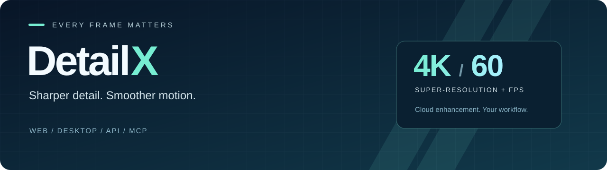

<p align="center">
  
</p>

<p align="center">
  <strong>细节更清晰，运动更流畅，融入你的创作流程。</strong><br>
  面向创作者、开发者和 AI 助手的视频超分与智能插帧服务。
</p>

<p align="center">
  <a href="https://www.detail-x.ai/">官方网站</a> ·
  <a href="https://www.detail-x.ai/video-upscaler/">真实效果对比</a> ·
  <a href="https://www.detail-x.ai/download">桌面客户端</a> ·
  <a href="MCP.zh-CN.md">MCP 接入指南</a> ·
  <a href="README.md">English</a>
</p>

# DetailX 视频增强

DetailX 为已有视频提供最高 **4K 超分辨率与 60 FPS 智能插帧**。无论是实拍素材、旧视频，还是 AI 生成视频，都可以选择增强参数，再与原片直接对比。

通过网页工作台、Windows/macOS 桌面客户端、REST API 或 **OAuth MCP 服务**使用同一套视频增强能力。增强推理在云端完成，无需本机配备推理显卡。

## 能做什么

| 能力 | 使用价值 |
| --- | --- |
| **视频超分** | 输出 720p、1080p、2K 或 4K，提供三档细节增强。 |
| **智能插帧** | 保留原帧率，或选择 24、30、60 FPS。 |
| **自然细节增强** | 改善发丝、肤质、织物、植被与材质纹理，可通过下方真实样例判断效果。 |
| **画面风格控制** | 提供颜色保持、光照校正、光流平滑等选项。 |
| **预览与对比** | 在可视化工作台进行单帧预览，以及原片与成片的同步播放对比。 |
| **慢动作** | 网页与桌面工作流支持 0.5×、0.25× 慢动作。 |
| **批量处理** | 从工作台提交多个视频，已受理任务在后台继续处理。 |
| **AI 助手接入** | 通过 MCP 查找素材、估价、提交已授权的增强任务并获取结果。 |

## 看真实效果

以下均为 DetailX 公开样例视频的原片与增强帧。请打开[在线动态对比](https://www.detail-x.ai/video-upscaler/)检查运动流畅度、帧间一致性与完整分辨率细节；静态图片无法展示插帧效果。

| 原片 · 480p | DetailX · 4K / 60 FPS 成片 |
| :---: | :---: |
|  |  |

| 原片 · 720p | DetailX · 4K / 60 FPS 成片 |
| :---: | :---: |
|  |  |

## 为什么选择 DetailX

- **清晰度与流畅度一起处理。** 在同一工作流组合超分与插帧，减少工具之间的素材流转。
- **先预览，再处理整段。** 在可视化工作台检查代表帧，按素材调整增强参数。
- **云端算力，多种入口。** 浏览器、桌面、代码或 AI 助手均可接入，增强推理由云端完成。
- **统一账户与积分。** 网页、直连接口和 MCP 共用同一 DetailX 账户、积分余额与任务记录。
- **MCP 先报价，确认后生成。** 提交前核对预计积分；增强任务失败或超时按服务计费规则退还预扣。
- **MCP 浏览器授权。** 无需手动复制 API Key，在账户页可管理或撤销已连接客户端。

## 选择你的使用方式

| 使用场景 | 入口 |
| --- | --- |
| 浏览器选片、预览与增强 | [打开 DetailX](https://www.detail-x.ai/) |
| 在 Windows/macOS 处理本地视频 | [下载桌面客户端](https://www.detail-x.ai/download) |
| 在 AI 助手中增强视频 | [MCP 接入与使用](MCP.zh-CN.md) |
| 为应用集成视频增强 | [API 接入与文档](https://www.detail-x.ai/integrations/api) |

## MCP 快速接入

**远程服务地址，保留末尾 `/`：**

```text
https://www.detail-x.ai/api/v1/mcp/
```

传输协议为 **Streamable HTTP**，认证使用带 **S256 PKCE 的浏览器 OAuth 授权**。需要 DetailX 账户，OAuth 凭据由 MCP 客户端自行管理。

### Codex

```sh
codex mcp add detailx --url "https://www.detail-x.ai/api/v1/mcp/"
codex mcp login detailx
codex mcp list
```

在浏览器完成登录与授权，再进入新的 Codex 会话。

### Claude Code

```sh
claude mcp add --transport http --scope local detailx "https://www.detail-x.ai/api/v1/mcp/"
claude
```

在会话中输入 `/mcp`，选择 `detailx`，按 **Authenticate** 提示登录并授权。

### 连上后可以这样说

> 使用 DetailX 查询我的积分余额和最近的视频素材，先不要生成。

> 把选中的视频按 4K、60 FPS 估价，先告诉我来源、参数和所需积分，不要提交。

> 按刚才的报价生成一次，持续查询同一条任务，完成后给我结果链接。

具备本地文件、命令和网络访问权限的客户端，还可以使用官方本地上传脚本。助手先调用 `get_upload_instructions` 获取实时限制；视频字节直接上传到存储，不经过 MCP 消息传输。

完整的配置文件、本地上传、工具、估价与重试规则、授权管理及排查方法见 **[MCP 接入指南](MCP.zh-CN.md)**。[English guide](MCP.md).

## 使用说明

生成会消耗 DetailX 积分。实际参数、报价、并发、上传限制和有效期以在线服务为准；通过 `get_capabilities`、`get_generation_capacity`、`get_upload_instructions` 获取当前信息，避免写死限制。请在页面显示的到期时间前下载结果。增强效果取决于源视频质量和参数。

本仓库提供产品介绍、公开对比素材和接入文档，视频处理通过 DetailX 在线服务完成。

[官网](https://www.detail-x.ai/) · [帮助中心](https://www.detail-x.ai/help) · [MCP 接入页](https://www.detail-x.ai/integrations/mcp) · [联系支持](mailto:support@detail-x.ai)
